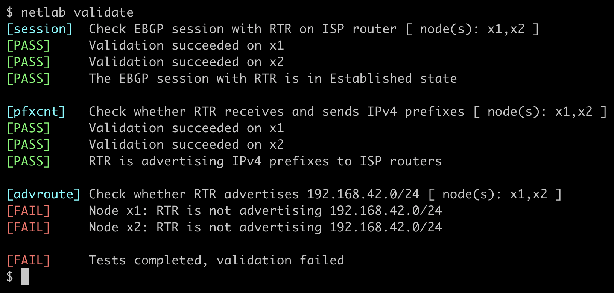

(netlab-validate)=
# Validate Lab Network

**netlab validate** executes tests defined in the **[validate](../topology/validate.md)** lab topology attribute on a running lab. It can be used in training labs to check whether the user has successfully completed the lab assignment.

## Usage

```text
usage: netlab validate [-h] [-v] [-q] [--list] [--node NODES] [--skip-wait] [-e]
                       [--source TEST_SOURCE] [--dump {result} [{result} ...]]
                       [--format {text,json}] [-i INSTANCE]
                       [tests ...]

Run lab validation tests specified in the lab topology

positional arguments:
  tests                 Validation test(s) to execute (default: all)

options:
  -h, --help            show this help message and exit
  -v, --verbose         Verbose logging (add multiple flags for increased verbosity)
  -q, --quiet           Report only major errors
  --list                List validation tests
  --node NODES          Execute validation tests only on selected node(s)
  --skip-wait           Skip the waiting period
  -e, --error-only      Display only validation errors (on stderr)
  --source TEST_SOURCE  Read tests from the specified YAML file
  --dump {result} [{result} ...]
                        Dump additional information during the validation process
  --format {text,json}  Output format (json: print only the JSON results on stdout)
  -i, --instance INSTANCE
                        Specify the lab instance to validate
```

The **netlab validate** command returns the overall test results in its exit code:

| Exit code | Meaning |
|----------:|---------|
| 0 | All tests passed |
| 1 | At least one test failed |
| 2 | `netlab validate` did not find a single usable test to execute |
| 3 | Some of the tests generated warnings |

## Example

**netlab validate** command was executed on the [Advertise IPv4 Prefixes to BGP Neighbors](https://bgplabs.net/basic/3-originate/) lab before the user configured BGP prefix origination:



```{tip}
* Use **‌netlab validate --error-only** to shorten the printout and display only the validation errors.
```

(netlab-validate-json)=
## JSON Results

Use **netlab validate --format json** to get machine-readable validation results. The command prints a single JSON document on the standard output and suppresses all other printouts (test headers, progress messages, verbose printouts, the summary results). Warnings and fatal errors are still printed on the standard error, and the exit code does not change.

The JSON document contains these top-level keys:

* **version**: JSON schema version (currently 1)
* **started**: The time the validation process started (UTC, ISO 8601 format, for example `2026-10-25T17:09:00Z`)
* **exit_code**: The exit code of the **netlab validate** command
* **aborted**: `true` if the validation process stopped early, for example, after a failed test with **stop_on_error** set, after an interrupt, or after a fatal error.
* **reason**: The reason for the early stop (only present when **aborted** is `true`)
* **summary**: The number of passed (**passed**), failed (**failed**), warning (**warning**), skipped (**skipped**) and execution error (**error**) results, and their total (**count**, which does not include skipped results). Execution errors are counted as failures (or warnings) in the exit code.
* **results**: A dictionary of test results, keyed by test name and sorted in the execution order

Each test result has these attributes:

* **description**: Test description (or `null`)
* **level**: Test severity level (`warning` or `null`)
* **result**: Test result: `pass`, `fail`, `warning`, `skip`, or `error`. The test result is the worst result of all nodes on which the test was executed (`error` is worse than `fail`, which is worse than `warning`, which is worse than `skip`), apart from tests that are expected to fail.
* **message**: The test-level message, for example, the **pass** message (or `null`)
* **elapsed**: The time (in seconds) from the start of the test to its final result, including the retries
* **nodes**: A dictionary of node results, keyed by node name. The dictionary is empty for tests that are not executed on individual nodes (for example, tests executing configuration templates).

Each node result has these attributes:

* **device**: Node device type
* **result**: Node result: `pass`, `fail` (a failed check), `warning` (a failed check in a test with **level** set to `warning`), `skip` (the test cannot be executed on the device), or `error` (the command could not be executed, the device printout could not be parsed, or the validation plugin crashed)
* **message**: The message that would be printed for the node
* **elapsed**: The time (in seconds) from the start of the test to the final node result

**Example:**

```json
{
  "version": 1,
  "started": "2026-10-25T17:09:00Z",
  "exit_code": 1,
  "aborted": false,
  "summary": { "count": 3, "passed": 2, "failed": 1, "warning": 0, "skipped": 0, "error": 0 },
  "results": {
    "session": {
      "description": "Check BGP sessions with DUT",
      "level": null,
      "result": "fail",
      "message": null,
      "elapsed": 30.2,
      "nodes": {
        "x1": { "device": "frr", "result": "pass", "elapsed": 1.2,
                "message": "Neighbor 10.1.0.1 (rtr) is in state Established" },
        "x2": { "device": "frr", "result": "fail", "elapsed": 30.2,
                "message": "The neighbor 10.1.0.5 (rtr) is in state Active (expected Established)" }
      }
    },
    "ping": {
      "description": "Ping-based reachability test",
      "level": null,
      "result": "pass",
      "message": "Test succeeded in 0.4 seconds",
      "elapsed": 0.4,
      "nodes": {
        "x1": { "device": "frr", "result": "pass", "elapsed": 0.4, "message": "Validation succeeded on x1" }
      }
    }
  }
}
```

Use **netlab validate --list --format json** to get the list of validation tests in JSON format. The document contains the **version** and **tests** keys; **tests** is a dictionary of tests with **description**, **nodes**, **devices**, and **wait** attributes.

(netlab-validate-dev)=
## Developing Validation Tests

Validation test development is usually an interactive process that requires several changes to the **validate** lab topology attribute before you get them just right. Restarting the lab every time you change the validation tests just to have them transformed and stored in the snapshot file is tedious; these changes to **netlab validate** (introduced in release 25.12) streamline the process:

* The **netlab validate** command compares the timestamp of the lab topology file with the timestamp of the snapshot file. When necessary, it rereads the validation tests from the changed lab topology file.
* You can develop the validation tests in a separate YAML file and run them with the **netlab validate --source** CLI option. After the validation tests are complete, copy them into the lab topology.

```{tip}
Use the verbose flag (`-v` or `-vv`) to display commands executed on lab devices, the returned printouts, the parsed results, and the results of the validation plugins.
```
